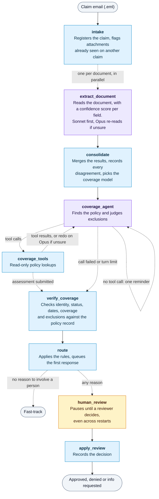

# Claims intake agent

> **Status:** reference implementation built on mock systems and synthetic claims. The tests run offline with
> scripted model answers. See [Before using it for real](#before-using-it-for-real).

This LangGraph workflow reads a claim email and its attachments (photos, invoices, police reports), extracts the
details into a claims system and checks them against the policy. It then either sends the claim to fast-track or
pauses it for a person. Claude reads the documents and judges policy wording. Plain code decides the route, so
nothing written in a document can approve a claim.



Purple steps call Claude, blue steps are plain code, and the amber step waits for a person. Dotted lines are
conditional. Every step writes to a tamper-evident audit log.

## Quick start

The tests need no API key:

```bash
python -m venv .venv && source .venv/bin/activate
pip install -e ".[dev]"
pytest
```

The eval runs 17 synthetic claims through real Claude, which costs real API usage:

```bash
export ANTHROPIC_API_KEY=your-key
claims-eval --limit 3    # start small and check the cost in the summary
claims-eval
```

## Benefits

Simple claims can move without waiting in a queue, and claims handlers can spend their time on the ones that need
judgment. Every claim gets a first response as soon as it's processed.

This repo ships only synthetic test data, so it can't show accuracy, fast-track rates or time saved on real claims. On
the 17 test claims, a claim took about 9 seconds and $0.03 in API usage, with routing rules slightly older than the
current ones. Real claims with longer documents will take longer and cost more. To measure your own results, use the
[eval](#checking-accuracy) with real, reviewed claims.

**For claimants**

- **A fast first response:** each claim gets an acknowledgement with its reference and next step, whichever route it takes.
- **Quicker handling of simple claims:** a clean claim doesn't wait for a person to read it first.
- **A person for anything uncertain:** injuries, other parties, exclusions and unclear documents all go to a claims handler.

**For claims handlers**

- **Less data entry:** details are extracted from emails, invoices and police reports into the claims system.
- **Reviews that start with the reasons:** each claim arrives with why it needs a person and the coverage findings.
- **Evidence you can check:** extracted values are recorded with the passage they came from and a confidence score.
- **Problems surfaced early:** disagreements between documents, reused attachments and text aimed at automated systems are all flagged.

**For compliance and risk**

- **A full record of every claim:** document fingerprints, model readings, policy lookups, rule outcomes and reviewer decisions are all logged.
- **Tampering is detectable:** `claims audit verify` shows whether the log has been edited or had records removed.
- **Decisions you can explain:** routing comes from plain rules in code, so each outcome traces to named reasons and a rules version.
- **Safe failure:** a failed or refused model call sends the claim to a person, never to fast-track.
- **Resistance to manipulation:** nothing written in a document can approve a claim, and read-only tools mean Claude can't change a policy.

**For operations**

- **Cost that follows complexity:** Sonnet handles most of the work, and Opus is used only where a claim calls for it.
- **Limits you control:** thresholds, a daily cap and a kill switch are all settings, with no code changes needed.
- **No lost work:** a crash resumes from the last finished step, and a claim waiting for review survives restarts.
- **Replaceable connections:** the claims system and policy store sit behind small interfaces, so real systems can replace the mocks.

## Using it

```bash
claims run evals/cases/FT-01-glass/email.eml     # process one or more emails
claims watch ./inbox                             # process .eml files as they appear
claims review list                               # claims waiting for a person, with reasons
claims review show CLM-XXXXXXXXXXXX
claims review decide CLM-XXXXXXXXXXXX approve --reviewer "J. Reviewer" --note "Confirmed by phone"
claims audit show CLM-XXXXXXXXXXXX               # everything that happened to a claim
claims audit verify                              # check the log hasn't been altered
```

Review decisions are `approve`, `deny` and `request_info`. Settings are in [.env.example](.env.example). To stop all
new processing, create the file `data/CLAIMS_DISABLED`.

## When a claim goes to a person

A claim is fast-tracked only when none of these apply. The rules are in [routing.py](src/claims/routing.py) and
[coverage.py](src/claims/coverage.py).

| Area | Sent to a person when |
|---|---|
| **Extraction** | A required field is missing, or any required field is below the confidence threshold (default 0.85) |
| **Documents** | A document is unreadable, unsupported or too large, documents disagree, or an attachment already appears on another claim |
| **Manipulation** | A document contains text aimed at an automated system, or Claude notes a specific concern |
| **Evidence** | There's no readable invoice, or a theft or vandalism claim has no police report document |
| **Identity** | The claimant isn't the policyholder, or the email didn't come from the address on the policy |
| **Coverage** | The policy is inactive, the date is outside its period, the loss type isn't covered, or an exclusion applies |
| **Amount** | Over the fast-track limit (default $5,000), over the coverage limit, or not above the deductible |
| **Risk** | Injury or another party is involved, a collision claim doesn't rule both out, the report is late, the policy is new, or there are many recent claims |
| **Failure** | A Claude call fails or is refused, or the coverage check doesn't finish |

## Design decisions

- **Confidence isn't enough on its own.** A model's confidence score is its own estimate and isn't calibrated, so
  the threshold is one rule among many. The eval reports accuracy on high-confidence fields so you can see how far to
  trust it.
- **Documents are read one at a time.** Text in one document can't influence how another is read, and the code can
  compare independent readings.
- **Documents are untrusted.** Instructions inside them are flagged, not followed. A successful injection could still
  corrupt the values Claude reports, which is why identity, dates, limits and evidence are checked separately.
- **The email body can't serve as evidence.** A total stated there counts as the amount claimed, not as an invoice.
- **Failures go to a person.** There's no path where an error results in a fast-track.
- **The first response says nothing about the claim.** It gives only a reference and the next step, because the
  sender may not be who they claim to be.
- **Fast-track isn't a payment.** This workflow sets a status. Payment belongs to the downstream process.

## Which model handles what

Sonnet 5.5 handles most of the work. Opus 5.5 steps in for complex cases, chosen by code in
[escalation.py](src/claims/escalation.py):

| Step | Opus is used when |
|---|---|
| **Reading a document** | Sonnet's reading failed, it marked the document unreadable, or it was unsure of a field routing relies on. The document is then read again. |
| **Coverage check** | The claim is at or above `CLAIMS_COMPLEX_AMOUNT` (default $2,000, a placeholder), or one of its documents was re-read |
| **Coverage check, second try** | Sonnet's result was unsure and found no exclusion |

A claim already going to a person skips Opus, except for re-reading unclear documents. A second reading can't remove a
warning: injection flags, concerns and exclusions stay, and if the two readings disagree on a value, a person looks at it.

## Checking accuracy

`claims-eval` grades the route, the reason for it and key field values, then saves the results to `evals/results/`.
It exits with an error if any claim is wrongly fast-tracked.

| Metric | Meaning |
|---|---|
| `wrongly_fast_tracked` | Claims a person should have seen. This should be zero. |
| `fast_track_sent_to_person` | Simple claims that were over-escalated. This sets your fast-track rate. |
| `reason_correct` | Whether it escalated for the right reason, not by luck |
| `high_confidence_field_accuracy` | How far to trust high confidence scores |

To stress-test the rules, the `adversarial-case-writer` agent in Claude Code adds `ADV-` claims designed to get wrongly
fast-tracked. Each one is otherwise clean, so a fast-track result means the attack got through, and `claims-eval` reports
that as a failure. Check that each case is fair before trusting its result.

The 17 synthetic cases are a starting point and can't show real-world accuracy. They don't test real damage photos,
handwriting or unusual document layouts. Regenerate them with `python scripts/generate_cases.py`.

## Before using it for real

**Replace the mocks**
- `ClaimsSystem` and `PolicyStore` with clients for your systems, using a read-only account for policies.
- `claims watch` and the outbox folder with your mailbox and email sending.
- The SQLite checkpoints with a server database such as Postgres if you run more than one worker.
- The CLI review commands with your case-handling tool, using authenticated reviewer identities. The CLI accepts any
  reviewer name.

**Security and compliance**
- Check SPF, DKIM and DMARC results before trusting the sender. A `From` header alone can be forged.
- Have your data protection team approve what's sent to the API. Redaction covers email text only, so attachments
  are sent as received. Check your data retention terms with Anthropic.
- Encrypt `data/` and set retention rules, because it holds attachments, extracted details and checkpoints. Don't
  keep real claims data in a synced folder.
- Ship the audit log to write-once storage. Someone who can rewrite the whole file can rebuild the chain.
- Check your obligations for automated insurance decisions in each jurisdiction, including fairness testing and
  claimants' rights to human review. Have your compliance team sign off on the rules.

**Accuracy**
- Build an eval set from real, reviewed claims and measure against it before turning on fast-track.
- Run in shadow mode first, with every claim going to a person, and compare decisions.
- Sample fast-tracked claims for review on an ongoing basis.
- Set the limits in `.env.example` with your claims team. The defaults are placeholders.

**Known limits**
- A `request_info` decision ends the run, and the claimant's reply starts a new claim, so replies need linking to the original.
- Claims with several invoices go to a person, because differing totals count as a conflict.
- Forged documents that look consistent won't be caught. Fraud screening needs its own tooling.

## Project layout

| Path | Contents |
|---|---|
| [src/claims/graph.py](src/claims/graph.py) | The LangGraph workflow |
| [src/claims/llm.py](src/claims/llm.py) | All calls to Claude |
| [src/claims/prompts.py](src/claims/prompts.py) | Prompts |
| [src/claims/routing.py](src/claims/routing.py), [coverage.py](src/claims/coverage.py), [consolidation.py](src/claims/consolidation.py) | The rules, with no model involved |
| [src/claims/audit.py](src/claims/audit.py) | The audit log |
| [src/claims/claims_system.py](src/claims/claims_system.py), [policies.py](src/claims/policies.py) | Mock systems to replace |
| [evals/cases/](evals/cases) | Synthetic claims |
| [tests/](tests) | Offline tests, with Claude's answers scripted |
| [CLAUDE.md](CLAUDE.md) | Instructions for Claude Code: commands, architecture and rules to keep |
| [.claude/](.claude) | Claude Code settings, the test hook, skills, and agents for safety review and adversarial cases |
